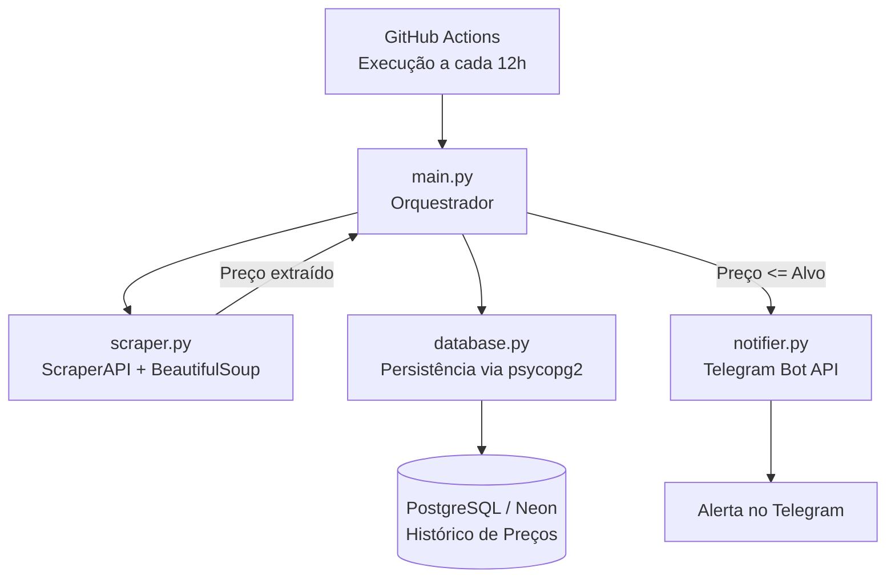

# Price Tracker — Monitoramento Automatizado de Preços

Pipeline automatizado em Python para monitoramento periódico de preços em e-commerces (padronizado para a Amazon Brasil), com persistência de histórico em PostgreSQL e envio de alertas via Telegram. A execução ocorre de forma agendada e *serverless* por meio do **GitHub Actions**, eliminando a necessidade de servidor dedicado.


---

## Sumário

1. [Visão Geral](#visão-geral)
2. [Arquitetura e Fluxo de Execução](#arquitetura-e-fluxo-de-execução)
3. [Estrutura do Repositório](#estrutura-do-repositório)
4. [Tecnologias Utilizadas](#tecnologias-utilizadas)
5. [Configuração Passo a Passo](#configuração-passo-a-passo)
6. [Estrutura do Banco de Dados](#estrutura-do-banco-de-dados)
7. [Agendamento (GitHub Actions)](#agendamento-github-actions)
8. [Exemplo de Notificação](#exemplo-de-notificação)
9. [Autor](#autor)

---

## Visão Geral

O projeto resolve dois problemas práticos de forma integrada:

1. **Alertas em tempo real:** monitora periodicamente uma lista configurável de produtos e dispara uma notificação no Telegram assim que o valor encontrado atinge ou fica abaixo do preço-alvo estipulado.
2. **Coleta de série histórica:** grava cada preço capturado em um banco relacional na nuvem, permitindo análises temporais posteriores — como a avaliação real de descontos em períodos sazonais (ex.: Black Friday).

Embora os exemplos utilizem a Amazon Brasil como padrão, o coletor é genérico e pode ser adaptado para outros sites ajustando-se a URL, a tag HTML e a classe CSS do elemento de preço.

---

## Arquitetura e Fluxo de Execução



## Estrutura do Repositório
```
Price_Tracker_Actions/
├── .github/
│   └── workflows/         # Workflow do GitHub Actions
├── main.py                # Orquestrador principal: itera sobre os produtos
├── scraper.py             # Web scraping via ScraperAPI + BeautifulSoup
├── database.py            # Conexão e persistência no PostgreSQL
├── notifier.py            # Envio de alertas via Telegram Bot API
├── requirements.txt       # Dependências Python
└── README.md              # Documentação
```
---
## Tecnologias Utilizadas

| Camada | Tecnologia | Finalidade |
| :--- | :--- | :--- |
| **Linguagem** | Python 3 | Orquestração e lógica do pipeline |
| **Coleta de Dados** | `requests`, `beautifulsoup4`, ScraperAPI | Requisições com bypass anti-bot e parsing de HTML |
| **Banco de Dados** | PostgreSQL (Neon), `psycopg2-binary` | Armazenamento persistente da série histórica |
| **Notificações** | Telegram Bot API | Disparo automático de alertas de preço |
| **Automação / CI** | GitHub Actions | Execução agendada sem custo de servidor fixo |

---


## Configuração Passo a Passo

### 1. Pré-requisitos e Credenciais

Antes de executar o projeto, crie e obtenha as credenciais dos três serviços abaixo:

- **ScraperAPI:** crie uma conta em [scraperapi.com](https://www.scraperapi.com/) e copie sua `API Key`.
- **Telegram Bot:**
  1. Inicie uma conversa com o [@BotFather](https://t.me/BotFather), execute o comando `/newbot` e guarde o **Token** gerado.
  2. Obtenha o seu **Chat ID** (por exemplo, enviando uma mensagem ao bot e consultando `https://api.telegram.org/bot<SEU_TOKEN>/getUpdates` ou utilizando bots auxiliares como `@userinfobot`).
- **PostgreSQL (Neon):** crie um projeto em [neon.com](https://neon.com) e copie a *Connection String* (`DATABASE_URL`).

### 2. Configuração dos Secrets no GitHub

Para manter as credenciais seguras, não as insira diretamente no código-fonte. No repositório do GitHub, acesse **Settings > Secrets and variables > Actions** e adicione:

| Secret | Descrição |
| :--- | :--- |
| `SCRAPER_API_KEY` | Chave de autenticação da ScraperAPI |
| `TOKEN_KEY` | Token do bot gerado pelo `@BotFather` |
| `CHAT_ID_KEY` | ID do chat ou usuário que receberá os alertas |
| `DATABASE_URL` | String de conexão do banco PostgreSQL |

### 3. Cadastro de Produtos Monitorados

Abra o arquivo `main.py` e edite a lista `LISTA_PRODUTOS`:

```python
LISTA_PRODUTOS = [
    {
        "nome": "Nome do Produto",
        "url": "https://www.amazon.com.br/...",
        "alvo": 299.99,          # Preço-alvo para disparo do alerta
        "tag": "span",           # Tag HTML que contém o preço
        "classe": "a-offscreen"  # Classe CSS do elemento
    },
]
```
**Como identificar `tag` e `classe` corretamente:**
1. Abra a página do produto no navegador, clique com o botão direito sobre o preço e selecione **Inspecionar**.
2. Identifique a tag HTML e o atributo `class` que envolvem o valor exibido.
3. Na Amazon Brasil, os seletores mais comuns são `a-offscreen` (preço completo oculto para leitores de tela) e `a-price-whole` (parte inteira do valor).
4. Verifique se a página possui anúncios ou itens recomendados com a mesma classe para garantir que o seletor seja específico.

### 4. Dependências 

```
requests
beautifulsoup4
psycopg2-binary
```

Instale localmente com:

```bash
pip install -r requirements.txt
```

---


### 5. Execução Local (Opcional)

Para testar o pipeline localmente antes de depender do agendamento no GitHub Actions:

```bash
# 1. Clone o repositório
git clone https://github.com/JoaoQAlisson/price_tracker_new.git
cd price_tracker_new

# 2. Crie e ative um ambiente virtual
python -m venv .venv

# Windows (PowerShell):
.venv\Scripts\Activate.ps1

# Linux / macOS:
source .venv/bin/activate

# 3. Instale as dependências
pip install -r requirements.txt
```

Defina as variáveis de ambiente (`SCRAPER_API_KEY`, `TOKEN_KEY`, `CHAT_ID_KEY` e `DATABASE_URL`) no seu terminal e execute:

```bash
python main.py
```

---

## Estrutura do Banco de Dados

Na primeira execução, o módulo `database.py` garante a criação automática da tabela `registros` caso ela ainda não exista:

```sql
CREATE TABLE IF NOT EXISTS registros (
    id        SERIAL PRIMARY KEY,
    produto   TEXT NOT NULL,
    preco     REAL NOT NULL,
    data_hora TEXT NOT NULL
);
```

| Coluna | Tipo | Descrição |
| :--- | :--- | :--- |
| `id` | `SERIAL` | Identificador único autoincremental |
| `produto` | `TEXT` | Nome do produto conforme definido na configuração |
| `preco` | `REAL` | Valor capturado durante a execução |
| `data_hora` | `TEXT` | Data e hora em que a captura foi efetuada |

---

## Agendamento (GitHub Actions)

O arquivo de workflow localizado em `.github/workflows/` define a execução automática do pipeline a cada **24 horas** por meio de expressão `cron`. Ao final de cada execução, a máquina virtual é descartada, mantendo a solução operacional sem necessidade de servidores dedicados ativados full-time.

---

## Exemplo de Notificação

Quando um produto atinge ou fica abaixo do preço estipulado, o bot envia uma mensagem formatada:

```text
🚨 ALERTA DE PREÇO!

Produto XX atingiu o alvo!
Valor Atual: R$ 429,90
Valor Desejado: R$ 450,01

🔗 Link para compra
```

---

## Autor
Desenvolvido por **João Alisson** — [GitHub](https://github.com/JoaoQAlisson) | [Portfólio](https://joaoqalisson.github.io/Data_portifolio_JA/)

*Nota: este projeto contou com o auxílio de ferramentas de Inteligência Artificial Gemini Neon para suporte no desenvolvimento e na documentação, com revisão e validação integral do autor.*